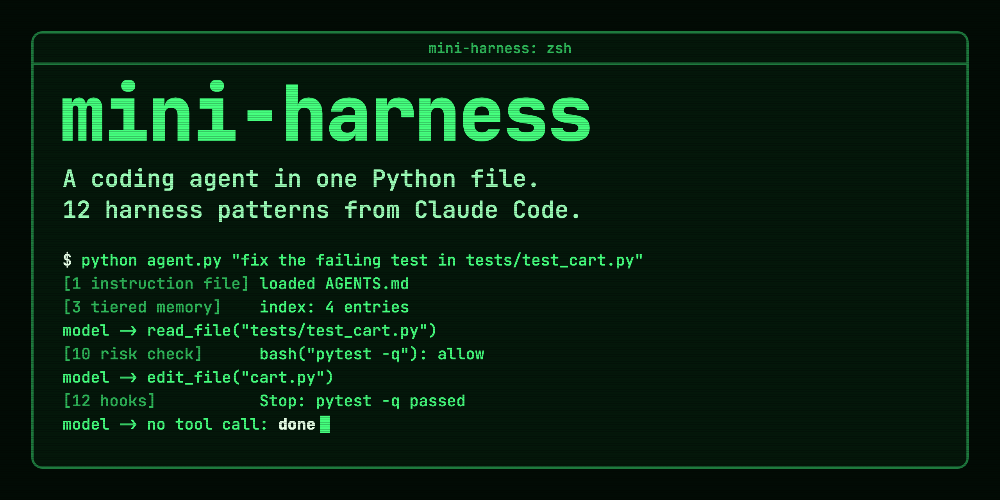
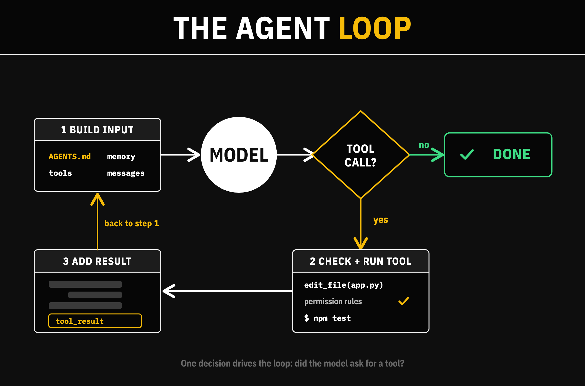
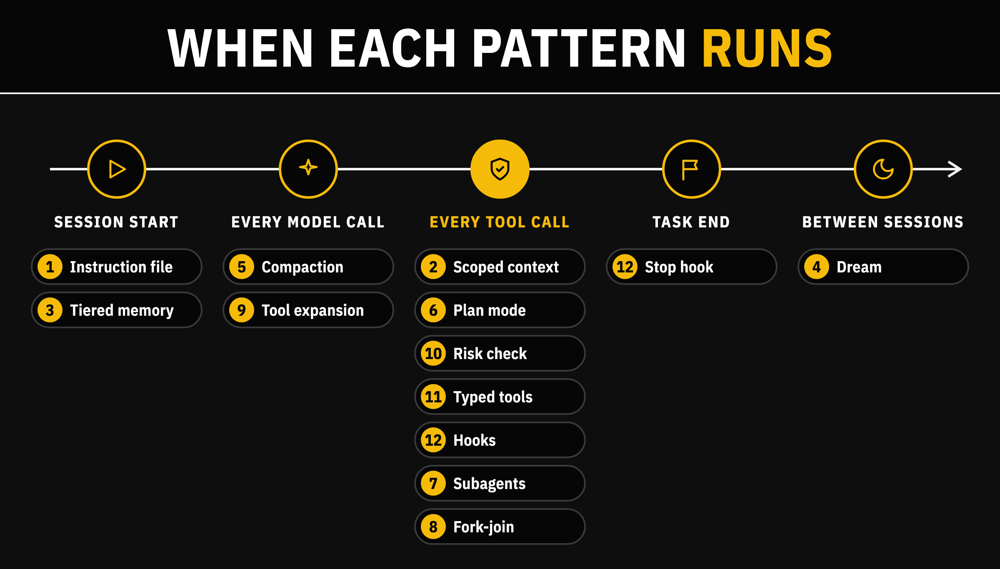

# mini-harness



**A coding agent in one Python file, built on the 12 harness patterns of Claude Code.**

Agent = model + harness. The model reads text and writes text. The harness is the code around it: it builds the input, runs the tools, checks the permissions and decides when the work is done. Claude Code and your own agent can call the same model, so the harness explains most of the difference in results.

mini-harness implements each of Claude Code's 12 harness patterns in the smallest code that shows the mechanism. `agent.py` is about 600 lines. Read it top to bottom: each `PATTERN n` section is one pattern.

This is the companion repo of the [Craft Better Software](https://craftbettersoftware.com) article *"Steal Claude Code's Harness for Your Own Agent"*.



## Quickstart

```bash
git clone https://github.com/dmoka/mini-harness && cd mini-harness
pip install -r requirements.txt
export ANTHROPIC_API_KEY=...

cd ~/code/your-repo
python ~/mini-harness/agent.py "fix the failing test in tests/test_cart.py"
```

No API key? If the `claude` CLI is logged in, use it as the model:

```bash
MINI_HARNESS_BACKEND=claude-cli python ~/mini-harness/agent.py "fix the failing test"
```

Other modes:

```bash
python agent.py --plan "add a /health endpoint"   # read-only until you approve the plan
python agent.py --consolidate                     # clean up the memory now (it also runs in the background after a session)
python agent.py                                   # chat mode: one session, many tasks
```

The default model is `claude-opus-5-5`. Set `MINI_HARNESS_MODEL` to use another one.

## The 12 patterns



| # | Pattern | What the harness does | In `agent.py` |
|---|---|---|---|
| 1 | Persistent instruction file | Reads `AGENTS.md` from disk and puts it into every model call | `build_prompt`, `load_rules` |
| 2 | Scoped context assembly | Loads a subfolder's `AGENTS.md` the first time a tool touches a file in it | `rules_for`, `on_file_touched` |
| 3 | Tiered memory | Sends a 200-line memory index on every call; topic files only on request | `memory_index`, `read_memory` |
| 4 | Dream consolidation | When a session ends and the memory changed, a background process merges duplicate notes and deletes stale ones | `start_dream`, `consolidate_memory` |
| 5 | Progressive context compaction | Near the limit, stubs old tool outputs and replaces old turns with a summary | `maybe_compact`, `compact` |
| 6 | Explore-plan-act loop | Plan mode refuses write tools until you approve the plan | `call_tool`, `exit_plan` |
| 7 | Context-isolated subagents | Runs a task in a new, empty conversation; only the final report comes back | `run_subagent` |
| 8 | Fork-join parallelism | Runs several subagent calls from one answer at the same time, optionally in git worktrees | `run_tool_calls`, `new_worktree` |
| 9 | Progressive tool expansion | Lists every tool in one line; sends the full schema only after `load_tools` | `build_prompt`, `load_tools` |
| 10 | Command risk classification | Splits a shell command at `&&`, `\|\|`, `;`, `\|` and checks each part against deny, ask and allow rules | `classify` |
| 11 | Single-purpose tool design | Typed tools with exact-match edits; errors go back to the model as text | `read_file`, `edit_file`, `grep`, `glob` |
| 12 | Deterministic lifecycle hooks | Runs your shell commands before a tool, after a tool and before the agent finishes; exit code 2 blocks | `run_hooks` |

## Configure it

Put rules in `AGENTS.md` at the repo root and in any subfolder. Put permissions and hooks in `.agent/settings.json`:

```json
{
  "permissions": {
    "deny":  ["rm -rf", "git push (-f|--force)", "\\.env\\b"],
    "ask":   ["^git push"],
    "allow": ["^npm test", "^git (status|diff|log)"]
  },
  "hooks": {
    "PreToolUse":  ["./scripts/block-secrets.sh"],
    "PostToolUse": [],
    "Stop":        ["npm test >&2 || exit 2"]
  }
}
```

- A command that matches no rule is an **ask**: the agent asks you before it runs.
- A hook gets the event as JSON on stdin. Exit code 2 blocks the action, and the hook's stderr goes back to the model.
- A `Stop` hook that exits with 2 sends the agent back into the loop, at most 3 times. The example above means the agent cannot finish while the tests fail.
- Memory lives in `.agent/memory/`: `MEMORY.md` is the index, one `.md` file per topic. The background cleanup writes its log to `.agent/memory/dream.log` and records its last run in `.agent/memory/.last-dream`.

Approval questions (plan mode, an `ask` command) read one line from stdin. `y` approves; anything else, or the end of input, is a no. `echo y | python agent.py --plan "..."` approves the plan; `</dev/null` declines every question.

## Two model backends

| | `sdk` (default) | `claude-cli` |
|---|---|---|
| Needs | `ANTHROPIC_API_KEY` | a logged-in `claude` CLI |
| Tool calls | native tool use | a JSON `tool_calls` block, parsed by `claude_cli.py` |
| Speed | one API call per step | one new `claude -p` process per step (3 to 10 s) |

The `claude-cli` backend turns off all Claude Code tools (`--tools ""`) and replaces its system prompt (`--system-prompt`), so mini-harness runs every tool and its permission rules, hooks and plan mode stay in force. `--setting-sources ""`, `--strict-mcp-config` and `--disable-slash-commands` keep out your user settings, hooks, CLAUDE.md files, MCP servers and skills. A reply with a malformed `tool_calls` block gets one retry with the parse error.

Environment variables: `MINI_HARNESS_BACKEND`, `MINI_HARNESS_MODEL`, `MINI_HARNESS_CLI_TIMEOUT` (seconds per call, default 300), `MINI_HARNESS_CLAUDE_BIN` (path to `claude`).

## Tests

```bash
pip install pytest
pytest -q
```

42 tests, at least one per pattern. A fake model replaces `call_model`, so the tests make no API calls. `tests/test_claude_cli.py` tests the CLI backend's prompt rendering and reply parsing without running `claude`.

## Where Claude Code does more

This repo shows the mechanism of each pattern in the smallest code. Claude Code adds MCP servers, a full permission rule language, server-side compaction, a background memory process and a terminal UI.

No code from the Claude Code source leak is used. Every pattern is written from scratch, from public pattern descriptions and the Claude Code docs.

## License

MIT
